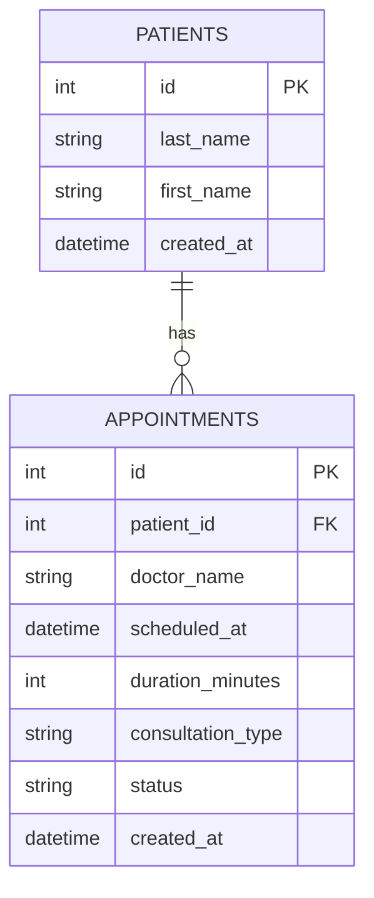

# Data Model

CareFlow stores two entities: **patients** and **appointments**.
A patient can have many appointments; an appointment belongs to exactly one patient.

## Entity relationship diagram

## Table `patients`

| Field | Type | Required | Validation |
|---|---|---|---|
| `id` | integer | yes | auto-generated |
| `last_name` | text | yes | not empty, no digits, max 100 characters |
| `first_name` | text | yes | not empty, no digits, max 100 characters |
| `created_at` | date + time | yes | set automatically by the system |

## Table `appointments`

| Field | Type | Required | Validation |
|---|---|---|---|
| `id` | integer | yes | auto-generated |
| `patient_id` | integer | yes | must reference an existing patient |
| `doctor_name` | text | yes | not empty, no digits, max 100 characters |
| `scheduled_at` | date + time | yes | must be in the future on creation |
| `duration_minutes` | integer | yes | between 15 and 30 |
| `consultation_type` | closed list | yes | one of: `urgent`, `follow_up`, `first_visit` |
| `status` | closed list | yes | one of: `scheduled`, `cancelled`, `completed`, `no_show` |
| `created_at` | date + time | yes | set automatically by the system |

## Appointment status lifecycle

- `scheduled` → `cancelled`
- `scheduled` → `completed`
- `scheduled` → `no_show`

Final states: `cancelled`, `completed`, `no_show` (no further transitions allowed).
A new appointment always starts as `scheduled`.

## Design decisions

- Patients are stored in a separate table to avoid duplicates and to keep each patient's appointment history.
- Cancelling an appointment changes its status instead of deleting it, to keep history.
- Data that can be computed (e.g. whether it is a patient's first visit) is not stored.
- `doctor_name` is plain text for the MVP; it may become a separate table later.